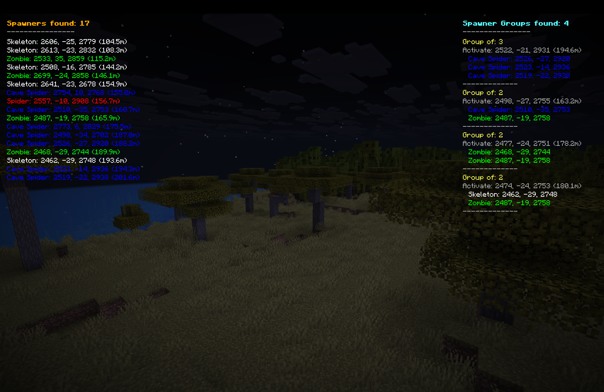

# SpawnerFinder

A client-side Minecraft mod that displays nearby mob spawners in your HUD with color-coded information showing spawner type, coordinates, and distance to help you locate dungeons efficiently.

> [!NOTE]
> **Exciting New Update for Minecraft 26.2!** 🚀
> We are thrilled to announce **SpawnerFinder v2.2.0**! This update introduces a full **Spawner History Table GUI**, persistent world/server spawner saving, destroyed spawner detection, multi-pinning support with top HUD highlights, dynamic search distance slider capped to render distance, and native hover tooltips across all controls.

## 📸 Screenshots

*SpawnerFinder HUD displaying nearby mob spawners with coordinates and distances*

## 🎯 Features

### Core Functionality
- **Real-time Spawner Detection** - Automatically scans for mob spawners within your active render distance.
- **Color-Coded Display** - Each mob type has a unique color for instant recognition.
- **Distance Tracking** - Shows exact distance to each spawner in meters.
- **Coordinate Display** - Provides precise X, Y, Z coordinates for easy navigation.
- **High-Fidelity HUD Overlay** - Clean overlay with transparent background boxes to keep stats legible in all environments.
- **Mob Head / Spawn Egg Icons** - Visual icon renders next to each spawner type for intuitive reading.

### Advanced Features (New in v2.2.0)
- **Interactive Spawner History Table (`H` key)** - Full-screen wide table displaying all previously discovered spawners and clusters per world/server. Click any column header (**Name**, **Coordinates**, **Distance**, **Date Found**, **Pin**) to sort table entries instantly.
- **Persistent Spawner & Cluster Storage** - Saves every discovered spawner and cluster into `<configDir>/spawnerfinder_saves/<serverId>.json` (capped at 25,000 entries with smart pruning).
- **Destroyed Spawner Detection** - Re-validates saved spawners upon revisiting loaded chunks; if mined, displays them in gray text with `[X]` tag and `Items.BARRIER` icon.
- **Multi-Pinning & Top HUD Overlay Display** - Pin multiple spawners or clusters (`[★ Pin]`) to lock them at the very top of your in-game HUD overlay with a Star `§e★` tag and `NETHER_STAR` icon.
- **Search Distance Slider** - Slider in the Search GUI allowing users to adjust search radius from 0 to active client/server render distance limit.
- **Clear All Pins & Red Warning Tooltips** - Quick `Clear Pins` button with red warning hover hints (`"§cClears all pinned spawners and clusters. You can re-pin any item anytime from History."`) and native `setTooltip` hints on all controls.
- **Interactive Search GUI (`U` key)** - Filter spawners in real-time by typing mob names with TAB suggestions.
- **Custom Modpack & Server Support** - Scans the game's registry dynamically to identify modded/non-vanilla spawners.
- **Spawner Group Finder** - Automatically detects spawners within activation range of each other (16 blocks) and calculates the exact coordinate centroid where you should stand to run multiple spawners at the same time.
- **Screen-Height Expansion (`I` key)** - Toggle between compact (top 5) and expanded list views using the `I` key to see everything in range.

### Supported Mob Types
| Mob Type | Color | Hex Code |
|----------|-------|----------|
| Skeleton | White | `#FFFFFF` |
| Zombie | Green | `#00FF00` |
| Spider | Red | `#FF0000` |
| Cave Spider | Blue | `#0000FF` |
| Magma Cube | Orange | `#FF8000` |
| Blaze | Yellow | `#FFFF00` |
| Silverfish | Gray | `#808080` |
| Breeze | Light Blue | `#C0E0FF` |
| Bogged | Moss Green | `#5C714B` |
| Stray | Ice Blue | `#A0C0D0` |
| Husk | Sandy Brown | `#C2B280` |
| Slime | Lime Green | `#00FF80` |
| Unknown Types | Magenta | `#FF00FF` |

### Client-Side Only & Anti-Cheat Safe
- ✅ **100% Client-Side** - No server modifications required
- ✅ **Server Safe** - Cannot be detected by anti-cheat systems
- ✅ **No Network Traffic** - Uses only locally available data
- ✅ **Works on Any Server** - Compatible with vanilla and modded servers
- ✅ **HUD Only Display** - No visual overlays or ESP to avoid behavior detection

## 📋 Requirements

- **Minecraft**: 26.2
- **Fabric Loader**: 0.18.4 or higher
- **Fabric API**: 0.144.1+26.2 or higher
- **Java**: 25 or higher

## 🚀 Installation

1. **Install Fabric Loader** - Download from [FabricMC](https://fabricmc.net/use/)
2. **Download Fabric API** - Get it from [Modrinth](https://modrinth.com/mod/fabric-api) or [CurseForge](https://www.curseforge.com/minecraft/mc-mods/fabric-api)
3. **Download SpawnerFinder** - Get the latest release from the releases page
4. **Install the Mod** - Place `spawnerfinder-2.2.0.jar` in your `.minecraft/mods/` folder
5. **Launch Minecraft** - Start the game with the Fabric profile

## 🎮 Usage

### Keybindings & Controls
You can customize these controls in standard Minecraft settings:
- **`O`** - Toggle the entire SpawnerFinder HUD ON/OFF.
- **`I`** - Toggle Spawner List between **Compact** (shows top 5 spawners) and **Expanded** (shows all spawners in loaded chunks, utilizing full screen height).
- **`U`** - Open the **Spawner Search & Settings Screen**.
- **`H`** - Open the **Spawner History Table GUI**.

### In-Game Display
Once installed, the mod automatically starts working:
1. **Left Panel (HUD)** - Shows spawners found sorted by distance (closest first) with mob icons, coordinates, and distances: `Mob Type: X, Y, Z (Distance)`. Pinned spawners render at the very top with `§e★` tag and `NETHER_STAR` icon.
2. **Right Panel (HUD)** - Shows groups of spawners found within activation proximity, along with calculated coordinate centroid labeled `Activate: X, Y, Z`. Pinned clusters render at the top.
3. **Automatic Scanning** - Scans loaded chunks every 2 seconds asynchronously, ensuring zero performance drops.

## 🔧 Technical Details

### Performance
- **Chunk-Based Scanning** - Scans loaded chunk data instead of brute forcing block coordinates, giving massive FPS gains.
- **On-Demand GUI Caching** - History Table uses memory caching to run at 60+ FPS with zero lag spikes.
- **Memory Friendly** - Safety capped persistent storage (25,000 max entries) with automatic destroyed spawner pruning.

## 🔄 Version History

### v2.2.0 - History Table, Multi-Pinning, Cluster Details & Isolated World Saves (Minecraft 26.2)
**Complete Feature Additions & Enhancements:**
- **Updated to Minecraft 26.2** with modern Fabric rendering engine (`GuiGraphicsExtractor`, `CharacterEvent`).
- **Direct Singleplayer World Folder Saves**: Spawner history for singleplayer is stored directly inside each world's folder (`.minecraft/saves/<world_folder>/spawnerfinder_data.json`). Moving, backing up, or deleting worlds keeps spawner history 100% isolated and cleanly synced.
- **Spawner History Table GUI (`H` key)**: Wide interactive table UI displaying saved spawners and clusters. Click column headers (**Name**, **Coordinates**, **Distance**, **Count**, **Date Found**, **Pin**) to sort. Automatically fits screen height with page controls.
- **Cluster View & Detailed Mob Summaries**: Clusters are named by constituent mob types (e.g. `Zombie x2, Skeleton`). Includes a dedicated **Spawner Count** column and rich multi-line hover tooltips listing individual spawner coordinates.
- **Cluster & Mob Search Filter**: Typing mob names (e.g., `spider`, `zombie`, `skeleton`) searches both individual spawners and cluster mob summaries.
- **Destroyed Spawner Validation**: Automatically detects destroyed/mined spawners upon revisiting loaded chunks, rendering them grayed out with `[X]` strike-through formatting and a barrier icon.
- **Multi-Pinning & Top HUD Highlights**: Pin any spawner or cluster to display it at the top of the in-game HUD overlay with a Star `§e★` tag and `NETHER_STAR` icon.
- **Search Distance Slider & Render Distance Enforcement**: Dynamically bounded slider from 0 to active client/server render distance with server max render distance notification.
- **Clear All Pins**: Dedicated `Clear Pins` buttons with red safety warning tooltips and native hover hints on all buttons.

### v2.1.0 - Trial Spawner Detection & New Mobs
- Trial Spawner detection, custom icons, and Trial Mobs search toggle filter.

### v2.0.0 - The Ultimate Search & UI Update (Minecraft 26.1)
- Initial UI rewrite with Search GUI (`U` key), spawner grouping engine, and screen height expansion (`I` key).

---

## 📝 License

This project is licensed under the CC0-1.0 License - see the [LICENSE](LICENSE) file for details.